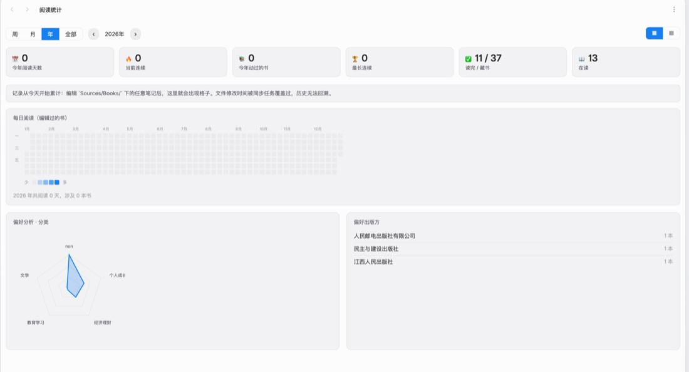
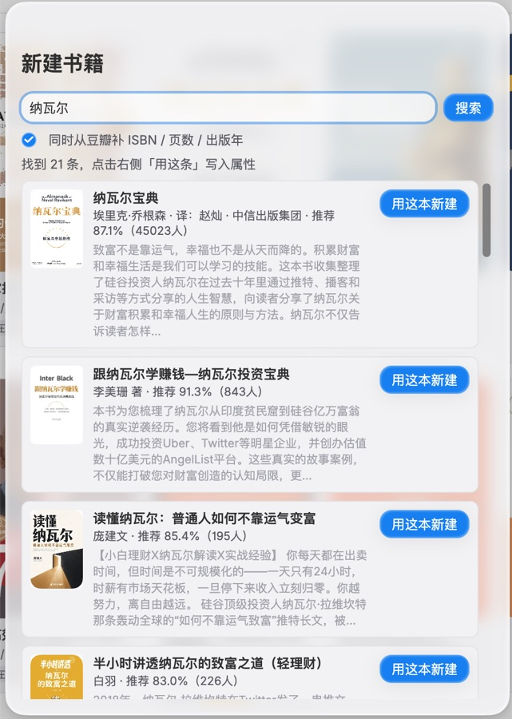
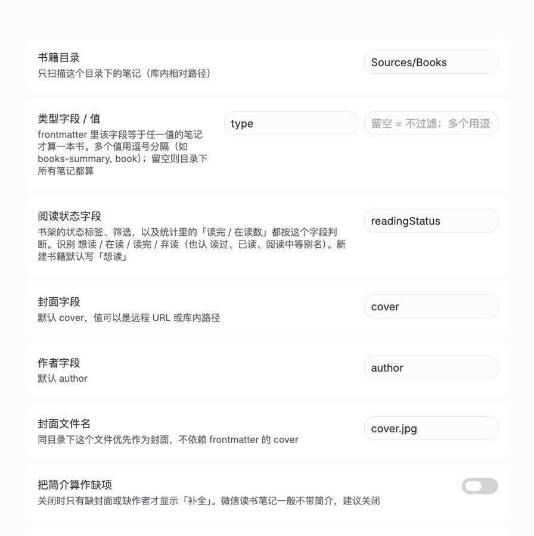

# YPP Book Shelf

把知识库里的书籍笔记显示成封面书架，并从微信读书 / 豆瓣补全封面与书籍属性。

Browse the book notes in your vault as a cover shelf, and complete covers and metadata from WeRead and Douban.

## 功能 / Features

- 以封面卡片浏览指定目录下的书籍笔记，支持搜索、6 种排序（最近修改 / 加入时间 / 书名 / 作者 / 评分 / 阅读状态）
- 一键从微信读书搜索书名，写入封面、作者、出版社、简介、评分
- 可选再从豆瓣补 ISBN、页数、出版年、出版社
- 新建书籍时按固定版式生成笔记（bookinfo 卡片 + 简介 callout + 标准属性）
- 缺字段的书显示「补全」按钮，右键（手机上点「⋯」）可重新拉取
- 阅读统计：按天记录你编辑过哪些书，画出年历热力图、每月柱状图、偏好分析（分类雷达 + 作者 / 出版社 Top）
- 统计对象可以是书籍目录，也可以换成任意目录（比如统计写作天数）

## 截图 / Screenshots

| 书架 Book shelf | 阅读统计 Reading stats |
|---|---|
|  |  |

| 新建书籍 New book | 设置 Settings |
|---|---|
|  |  |

## 安装 / Install

尚未上架社区市场，手动安装：

1. 在 Release 下载 `main.js`、`manifest.json`、`styles.css`
2. 放到 `<你的库>/.obsidian/plugins/ypp-book-shelf/`
3. 重启 Obsidian，在「第三方插件」里启用 **YPP Book Shelf**

## 界面语言 / Language

界面跟随 Obsidian 的语言设置（默认跟随系统）：中文显示中文，其它语言显示英文。文案表在 `src/i18n/`，中文原文即 key，缺项自动回退中文。

The UI follows Obsidian's language setting (which follows the system by default): Chinese when Obsidian is Chinese, English otherwise.

## 设置 / Settings

| 项 | 说明 |
|---|---|
| 书籍目录 | 只扫描这个目录，默认 `Books` |
| 类型字段 / 值 | frontmatter 里该字段等于任一值的笔记才算一本书，留空则目录下所有笔记都算 |
| 新建书籍的类型值 | 新建时写进 `type` 的值，留空则不写 |
| 阅读统计目录 | 留空跟书籍目录一致；填 `Content` 就统计写作 |
| 批量同步不计入 | 同步工具批量改写文件时不算作你读了一次 |

## 数据来源 / Data sources

插件只访问两个地址，不上传任何数据：

- `weread.qq.com` 的公开搜索接口（封面、作者、简介、评分）
- `book.douban.com` 的 `j/subject_suggest` 接口（ISBN、页数、出版年、出版社）

这两个接口都不是官方 API，随时可能变更或限流。请求失败时插件会提示，不会写入错误数据。

## 已知限制 / Limitations

- 封面以网络地址写入，不下载到本地；渲染时通过 Obsidian 的 `requestUrl` 绕开防盗链，图片会缓存在内存中（按会话）
- 阅读统计从启用后开始累计，无法回溯历史（同步工具会覆盖文件修改时间）
- 微信读书 / 豆瓣都是中文数据源，英文书的补全效果有限

## 版本 / Changelog

- **0.2.0** — 界面支持中英双语；目录设置项支持自动补全；读完/在读改按阅读状态字段判断；卡片操作增加「⋯」按钮（移动端可用）
- **0.1.0** — 首个版本

## License

MIT
